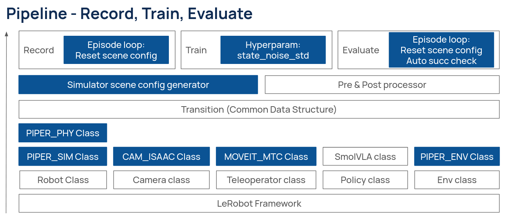
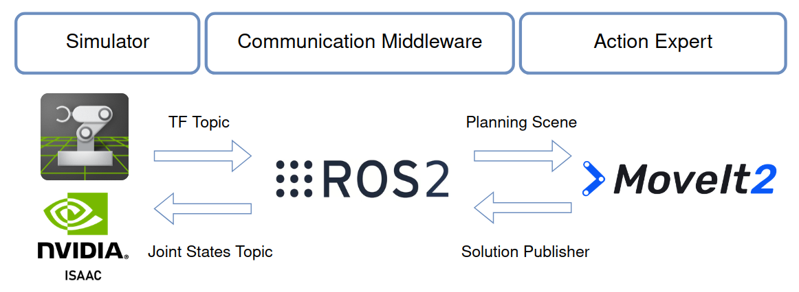
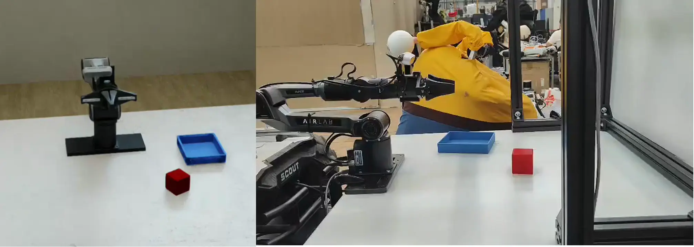

# LeRobot × AgileX PIPER: Sim & Real Pick-and-Place with SmolVLA

This repository is a fork of [🤗 LeRobot](https://github.com/huggingface/lerobot) (**v0.4.4**) adapted for the **AgileX PIPER** arm. It adds an Isaac Sim digital twin, a MoveIt2-based scripted teleoperator for automatic demonstration collection, scene-config-driven episode resets, and automatic success checking, so that the full **Record → Train → Evaluate** loop can run in simulation and on the real robot with [SmolVLA](https://huggingface.co/papers/2506.01844).

| Component | Version |
|---|---|
| LeRobot (base) | v0.4.4 |
| ROS 2 | Humble |
| Isaac Sim | 4.2 |
| Motion planning | MoveIt2 (Manipulation Task Constructor) |
| Training environment | PyTorch 2.10.0 + CUDA 12.8 (`2.10.0+cu128`) |

---

## 1. About LeRobot

LeRobot is Hugging Face's open-source PyTorch framework for real-world robotics. It provides a unified abstraction for robots, cameras, teleoperators, policies and environments, a standard dataset format (`LeRobotDataset`) with Hub integration, and ready-to-use scripts for data recording (`lerobot-record`), training (`lerobot-train`) and evaluation (`lerobot-eval`). It ships many policies, including ACT, Diffusion Policy, π0 / π0.5 and **SmolVLA**, a compact vision-language-action model built from a SmolVLM2 backbone and a flow-matching action expert.

This fork keeps LeRobot's abstractions and plugs PIPER-specific implementations into them.

---

## 2. What This Fork Adds



Blue boxes in the figure are the parts added or modified in this fork; white boxes are stock LeRobot.

| Layer | Component | What it does |
|---|---|---|
| Robot | `PIPER_PHY` (`robot.type=piper`) | Real-world PIPER robot class (joint control, state readout). |
| Robot | `PIPER_SIM` (`robot.type=isaac_piper`) | PIPER in Isaac Sim 4.2. Steps the simulation world, applies joint targets, returns joint states and camera frames, resets the scene from a scene config, and provides an automatic success check. |
| Camera | `CAM_ISAAC` (`robot.cameras.type=isaac`) | Camera class that reads RGB frames from Isaac Sim camera prims (e.g. top and wrist cameras). |
| Teleoperator | `MOVEIT_MTC` (`teleop.type=ros2`) | Teleoperator that receives MoveIt2 / Manipulation Task Constructor (MTC) trajectories over ROS 2, used to generate pick-and-place demonstrations automatically. |
| Policy | SmolVLA | Stock LeRobot SmolVLA policy, used as is. |
| Env | `PIPER_ENV` (`env.type=isaac_piper`) | Gymnasium environment wrapping `PIPER_SIM` for `lerobot-eval` (sync evaluation). |
| Shared | Transition (common data structure), Pre & Post processor | Stock LeRobot. |
| Tooling | Simulator scene config generator | Generates the per-episode scene CSV (see [Section 3](#3-scene-config-driven-record-and-evaluate)). |
| Loop | Record episode loop | Resets the simulator scene from the scene config at the start of every episode. |
| Loop | Train loop (`policy.state_noise_std`) | Inspired from [Zhao et al., 2025](https://arxiv.org/abs/2509.18644),zero-mean Gaussian noise with standard deviation `state_noise_std` is added to the normalized robot state before it enters the policy. |
| Loop | Evaluate episode loop | Resets the scene from the scene config and runs an **automatic success check**. |
| Async Evaluation | `lerobot_eval_async_auto.py` | Conbine the `policy_server.py` and  `robot_client.py` from `async_inference` folder. |

### How does the simulator work


### Demo videos

Recordings from the simulator Isaac Sim 4.2 and the real-world.




<!-- Example:
https://github.com/user-attachments/assets/<id>
width="320" height="240" 
https://github.com/user-attachments/assets/eb061179-6bd3-485c-874b-aebf9b766efc
-->

---

## 3. Scene-Config-Driven Record and Evaluate

Both recording and evaluation in simulation are driven by a **scene config CSV**. Each episode corresponds to one `episode_id`; the episode loop reads the rows for that id and places the objects accordingly on every reset. This makes data collection and evaluation fully reproducible: you can evaluate on exactly the same layouts used for training (in-distribution) or on held-out / OOD layouts.

Scene configs are generated with **[Jie-S14/generate_data](https://github.com/Jie-S14/generate_data)**.

### CSV format

One row per object per episode:

```csv
color,combo,episode_id,instruction,is_target,orientation_deg,role,stage,x,y
red,,0,pick up the cube and place it in the box,True,3.435118136210967,cube,D0a-cubeOnly,0.4455514899133138,0.05904161045558837
blue,,0,pick up the cube and place it in the box,False,90.0,box,D0a-cubeOnly,0.08,0.3
```

| Column | Meaning |
|---|---|
| `episode_id` | Episode index. All rows with the same id form one scene. |
| `role` | `cube` or `box`. |
| `color` | Object color (e.g. `red`, `green`, `blue`); used for language-grounding experiments. |
| `is_target` | Whether this object is the target of the instruction (matters when distractors are present). |
| `instruction` | Language instruction for the episode, used as the task string. |
| `x`, `y` | Object position (m) in the robot base frame. |
| `orientation_deg` | Object yaw. |
| `stage` | Dataset / experiment stage the row belongs to (e.g. `D0-joint`, `D0a-cubeOnly`, `D0b-boxOnly`, `D1`, `D2`, `D3`). |
| `combo` | Source→destination color combination (used by multi-object stages, empty otherwise). |

---

## 4. Using `robot.type=isaac_piper`

> **Scope:** `isaac_piper` currently supports **one task only: pick up a cube and place it into a box.**

Because object and robot prims are specific to your USD scene, you must point the robot config to your own simulation environment:

| Parameter | Description |
|---|---|
| `robot.stage_path` | Path to the `.usd` stage file. |
| `robot.robot_prim_path` | Prim path of the PIPER robot base in the stage (e.g. `/World/piper_official/base_link`). |
| `robot.object_prim_path` | Prim path of the cube to pick. |
| `robot.distractor_prim_path` | Prim path of the distractor cube. |
| `robot.goal_prim_path` | Prim path of the box (goal). |
| `robot.obj_zaxis_offset` | Z offset (m) used when placing the cube on the table from the scene config. |
| `robot.goal_zaxis_offset` | Z offset (m) used when placing the box on the table from the scene config. |
| `robot.obj_pose_path` | Path to the scene config CSV (Section 3). |

For recording, you must also set **`--teleop.type=ros2`**, so that trajectories planned by MoveIt2 / MTC are executed on the simulated arm (and recorded).

Cameras are Isaac Sim camera prims. The default setup uses two cameras, `top` and `wrist`, at 640×480 and 15 fps.

Notes:

- Isaac Sim 4.2 does not support multiple `SimulationApp` instances in one process, so the sim environment only supports a **single environment (`n_envs=1`)**.
- The default sim/control rate is **15 fps**; episodes time out after 300 steps in the sync env.

---

## 5. Installation

### Quick start (training / policy-server machine)

Tested with PyTorch **2.10.0+cu128**.

```bash
apt-get update
apt-get install -y git build-essential python3-dev vim
git clone --branch mask_state https://github.com/Jie-S14/lerobot.git /opt/lerobot
cd /opt/lerobot
pip install -e ".[smolvla]"
wandb login
huggingface-cli login
```

### Simulation / recording machine

Additionally requires:

- **ROS 2 Humble** and **MoveIt2** (with Manipulation Task Constructor) for the `ros2` teleoperator.
- **Isaac Sim 4.2**, run with Isaac Sim's bundled Python so that `omni.isaac.*` modules are available.
- A USD scene containing the PIPER robot, a cube (+ distractor), a box and the camera prims.

Source ROS 2 before launching any script that uses `teleop.type=ros2`:

```bash
source /opt/ros/humble/setup.bash
```

---

## 6. Usage

Paths, repo ids and prim names below are examples; replace them with your own.

### 6.1 Record (simulation, MoveIt2 teleop)

Start your MoveIt2 / MTC planner node first, then:

```bash
lerobot-record \
--robot.type=isaac_piper \
--robot.stage_path="/home/shenjie/usd/train/2cam_top_wst_goal_1pos_real_official.usd" \
--robot.robot_prim_path="/World/piper_official/base_link" \
--robot.object_prim_path="/World/object_block" \
--robot.distractor_prim_path="/World/distractor_block" \
--robot.goal_prim_path="/World/small_KLT" \
--robot.obj_pose_path="/home/shenjie/ws/generate_data/D0a/D0a-cubeOnly_episodes.csv" \
--robot.fps=15 \
--robot.cameras="{top: {type: isaac, prim_path: /World/TopCamera, width: 640, height: 480, fps: 15, warmup_steps: 10},wrist: {type: isaac, prim_path: /World/piper_official/camera_link/WristCamera, width: 640, height: 480, fps: 15, warmup_steps: 10}}" \
--dataset.fps=15 \
--dataset.repo_id=shenj/for_screenshot \
--dataset.root="/home/shenjie/Documents/for_screenshot" \
--dataset.single_task="pick up the cube and place it in the box" \
--dataset.num_episodes=20 \
--dataset.episode_time_s=30 \
--dataset.push_to_hub=false \
--dataset.private=false \
--teleop.type=ros2 \
--display_data=false \
--resume=false \
--seed=42
```

At the start of every episode the recorder resets the scene from the row(s) of `scene_config.csv` with the matching `episode_id`.

### 6.2 Train

Example: SmolVLA fine-tuning of the action expert (frozen vision encoder, pretrained VLM weights), 2 cameras, chunk size 50.

```bash
lerobot-train \
--dataset.root=/dataset/piper_isaacsim_top_wrist_D1_100ep_paired_poisson \
--dataset.repo_id=/dataset/piper_isaacsim_top_wrist_D1_100ep_paired_poisson \
--dataset.video_backend=pyav \
--num_workers=16  \
--batch_size=16  \
--steps=30000  \
--log_freq=1000  \
--save_freq=10000 \
--output_dir=/result/smolvla_result_20260914_3 \
--job_name=smolvla_train \
--dataset.image_transforms.enable=true \
--policy.chunk_size=50  \
--policy.n_action_steps=50 \
--policy.device=cuda  \
--policy.use_amp=true \
--policy.freeze_vision_encoder=true \
--policy.train_expert_only=false \
--policy.load_vlm_weights=true \
--policy.expert_width_multiplier=0.75 \
--policy.state_noise_std=0.1 \
--policy.repo_id=svla_piper_isaac_pickplace \
--policy.push_to_hub=false \
--wandb.enable=true  \
--wandb.disable_artifact=true \
--wandb.project=smolvla_train \
--wandb.notes="SmolVLA train"
```

Optional image augmentation (small brightness / contrast / sharpness jitter):

```bash
  --dataset.image_transforms.enable=true \
  --dataset.image_transforms.max_num_transforms=2 \
  --dataset.image_transforms.random_order=true \
  --dataset.image_transforms.tfs='{"brightness":{"weight":1.0,"type":"ColorJitter","kwargs":{"brightness":[0.95,1.1]}},"contrast":{"weight":1.0,"type":"ColorJitter","kwargs":{"contrast":[0.95,1.1]}},"sharpness":{"weight":1.0,"type":"SharpnessJitter","kwargs":{"sharpness":[0.95,1.05]}}}'
```

Multi-GPU training works through `accelerate launch`:

```bash
accelerate launch --multi_gpu --num_processes=3 $(which lerobot-train) <same args as above>
```

### 6.3 Synchronous evaluation

Policy and simulator run in the same process, and the policy blocks the control loop while it infers. Success is checked automatically by the environment.

```bash
lerobot-eval \
--policy.path=/smolvla_result/checkpoints/030000/pretrained_model \
--policy.n_action_steps=50 \
--env.type=isaac_piper \
--env.stage_path="/usd/2cam_top_wst_goal_blue_1pos_real_official.usd" \
--env.obj_pose_path="/scene_config/D0-ood_outer_eval_100ep_seed1728.csv" \
--env.robot_prim_path="/World/piper_official/base_link" \
--env.object_prim_path="/World/object_block" \
--env.distractor_prim_path="/World/distractor_block" \
--env.fps=15 \
--env.task=pick_place \
--eval.n_episodes=100 \
--env.episode_length=450 \
--eval.batch_size=1 \
--eval.use_async_envs=false \
--eval.save_trace=false \
--policy.device=cuda \
--policy.use_amp=false \
--seed=1000 \
--output_dir=/smolvla_piper_pickplace_run
```

`eval.batch_size` must be 1 (single Isaac Sim instance).

### 6.4 Asynchronous evaluation

Inference runs in a **policy server** (gRPC) while the **robot client** keeps executing actions from a queue, so inference latency does not stall the robot. This is the setting closest to real-robot deployment, and it also supports Real-Time Chunking (RTC) for flow-matching policies.

The evaluation script starts the policy server in-process and drives a `RobotClient` through all episodes of the scene config, then writes a results JSON and a per-step trace JSON (actions and joint states) to `results_folder`.

```bash
python lerobot_eval_async_auto.py \
--client.robot.type=isaac_piper \
--client.robot.stage_path="/usd/2cam_top_wst_goal_blue_1pos_real_official.usd" \
--client.robot.robot_prim_path="/World/piper_official/base_link" \
--client.robot.object_prim_path="/World/object_block" \
--client.robot.distractor_prim_path="/World/distractor_block" \
--client.robot.fps=15 \
--client.robot.cameras="{top: {type: isaac, prim_path: /World/TopCamera, width: 640, height: 480, fps: 15, warmup_steps: 10},wrist: {type: isaac, prim_path: /World/piper_official/camera_link/WristCamera, width: 640, height: 480, fps: 15, warmup_steps: 10}}" \
--client.robot.obj_pose_path="/scene_config/D0a-cubeOnly_eval_100ep_seed1728.csv" \
--client.task="pick up the cube and place it in the box" \
--client.server_address=127.0.0.1:8085 \
--client.policy_type=smolvla \
--client.pretrained_name_or_path="/smolvla_result/checkpoints/030000/pretrained_model" \
--client.policy_device=cuda \
--client.client_device=cpu \
--client.actions_per_chunk=50 \
--client.chunk_size_threshold=0.5 \
--client.fps=15 \
--client.aggregate_fn_name=weighted_average \
--client.debug_visualize_queue_size=true \
--server.port=8085 \
--server.fps=15 \
--server.obs_similarity_atol="[[0.1, 0.1, 0.1, 0.1, 0.1, 0.1, 0.05, 0.05]]" \
--start_episode=8 \
--end_episode=11 \
--episode_time_s=30.0 \
--results_folder="/results/smolvla_result_eval_ood/smolvla_result_eval"
```

Variants:

- `lerobot_eval_async_auto.py`: success is checked automatically by the simulator (`robot.check_success()`).
- `lerobot_eval_async.py`: the same loop, but the operator marks each episode's result with the keyboard.

Notes:

- **RTC** is switched on or off in the checkpoint's `config.json` (`rtc_config.enabled`); no code change is needed for A/B comparisons.
- The server skips an observation if its joint state is within a per-joint tolerance of the last predicted one (`--server.obs_similarity_atol`), to avoid redundant inference.
- `client.chunk_size_threshold` controls when a new observation is sent: a new chunk is requested when the queue falls below this fraction of the chunk size.

### 6.5 Physical PIPER async evaluation

Only change the robot-related parameters
```bash
--client.robot.type=piper \
--client.robot.cameras="{top: {type: opencv, index_or_path: /dev/video12, width: 640, height: 480, fps: 15},wrist: {type: opencv, index_or_path: /dev/video6, width: 640, height: 480, fps: 15}}"
```

---

## 7 Evaluation results

Seeds to generate scene configs: 1544 1728 1906

In distribution (ID) episodes: 300

Out of distribution (OOD) episodes: 200


---
## 8. Citation

```bibtex
@article{shukor2025smolvla,
  title={SmolVLA: A Vision-Language-Action Model for Affordable and Efficient Robotics},
  author={Shukor, Mustafa and Aubakirova, Dana and Capuano, Francesco and Kooijmans, Pepijn and Palma, Steven and Zouitine, Adil and Aractingi, Michel and Pascal, Caroline and Russi, Martino and Marafioti, Andres and Alibert, Simon and Cord, Matthieu and Wolf, Thomas and Cadene, Remi},
  journal={arXiv preprint arXiv:2506.01844},
  year={2025}
}

@misc{black2025realtimeexecutionactionchunking,
  title={Real-Time Execution of Action Chunking Flow Policies},
  author={Kevin Black and Manuel Y. Galliker and Sergey Levine},
  year={2025},
  eprint={2506.07339},
  archivePrefix={arXiv},
  primaryClass={cs.RO}
}

@misc{zhao2025needproprioceptivestatesvisuomotor,
      title={Do You Need Proprioceptive States in Visuomotor Policies?}, 
      author={Juntu Zhao, Wenbo Lu},
      year={2025},
      eprint={2509.18644},
      archivePrefix={arXiv},
      primaryClass={cs.RO},
      url={https://arxiv.org/abs/2509.18644}, 
}
```

## License

Apache 2.0, consistent with LeRobot.
